# Awaken — ZX Spectrum 128 (Mythos, 1999) — source code

Buildable source code of *Awaken*, an unreleased Elite-like space trading and combat game
for the ZX Spectrum 128K / TR-DOS by Mythos (1999). The authors' tokenized ZASM 3.10 and
STORM sources from the open-sourced developer disks were decoded and converted to
[sjasmplus](https://github.com/z00m128/sjasmplus). Protection is gone, all disk access goes
through one small layer, every text, table, picture, 3D model, sound and the music is an
editable file in `assets/`, and a web editor for the 3D models is included.
`python build.py` produces a bootable `.trd`. Documentation below is in Russian.

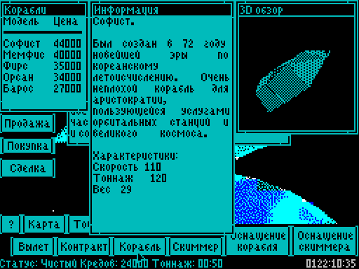

---

*Awaken* — космическая торговля и бои в духе Elite для ZX Spectrum 128K, группа Mythos, 1999.
Игра так и не вышла: были только демо-версии. Этот репозиторий — авторские исходники с дисков
разработчика (токенизированный ZASM 3.10 и STORM), приведённые к виду, который собирается
sjasmplus и удобен для правок, модов, локализации и, может быть, завершения игры:

* защита снята, вся работа с диском — в одном слое (`src/common/disk.asm`);
* станция и полёт связаны: вылет, стыковка, возврат с сохранением состояния, сохранения в 5 слотов;
* все тексты, таблицы, графика, 3D-модели, звуки и музыка лежат в `assets/` в редактируемом виде
  (UTF-8, CSV, PNG, текст, PT3), перед сборкой их переводят в игровой формат скрипты;
* код с шапками у каждого файла и понятными именами меток (старые имена — в комментариях
  и таблицах `docs/*_LABELS.md`);
* веб-редактор 3D-моделей с видом «как в игре».

## Скриншоты

| | |
|---|---|
| 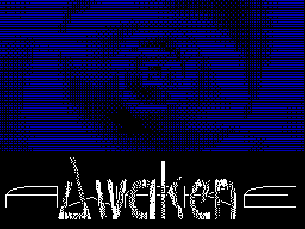 | 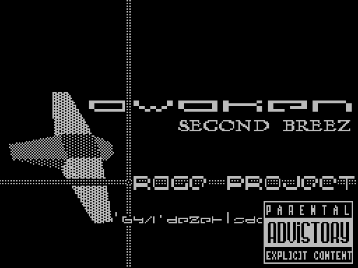 |
| 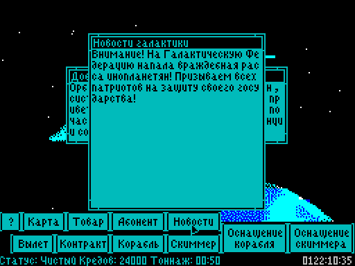 | 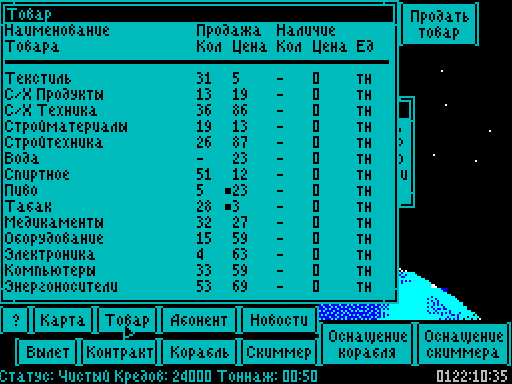 |
| 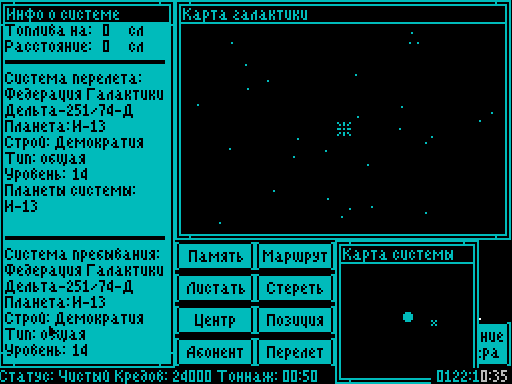 | 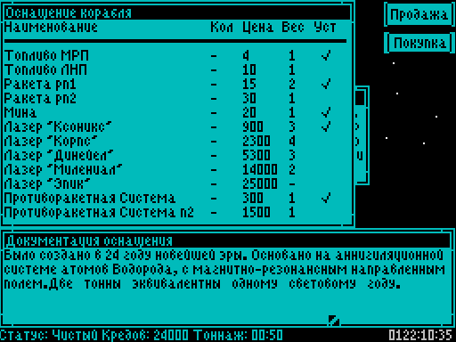 |
| 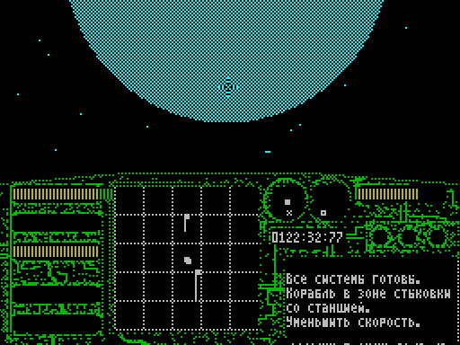 | 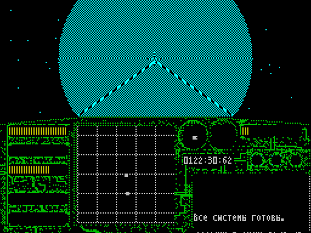 |
| 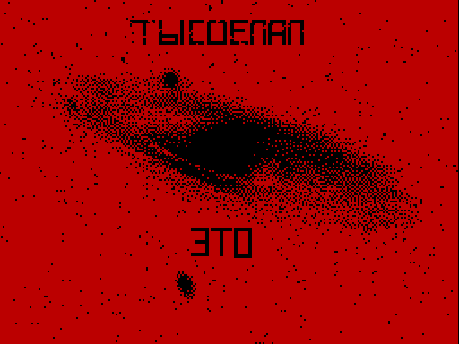 |  |

Редактор моделей (`tools/model_editor`):

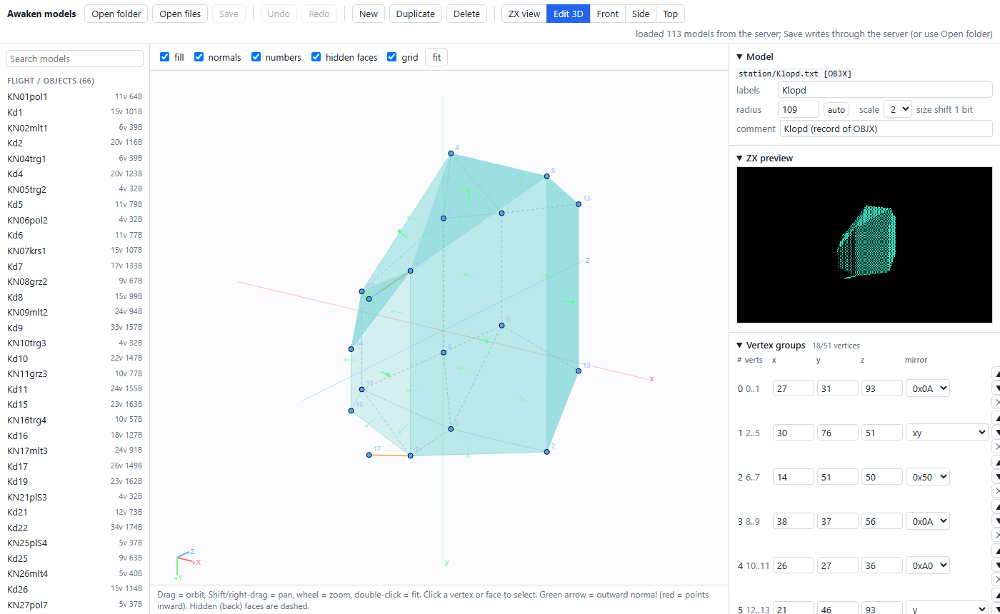
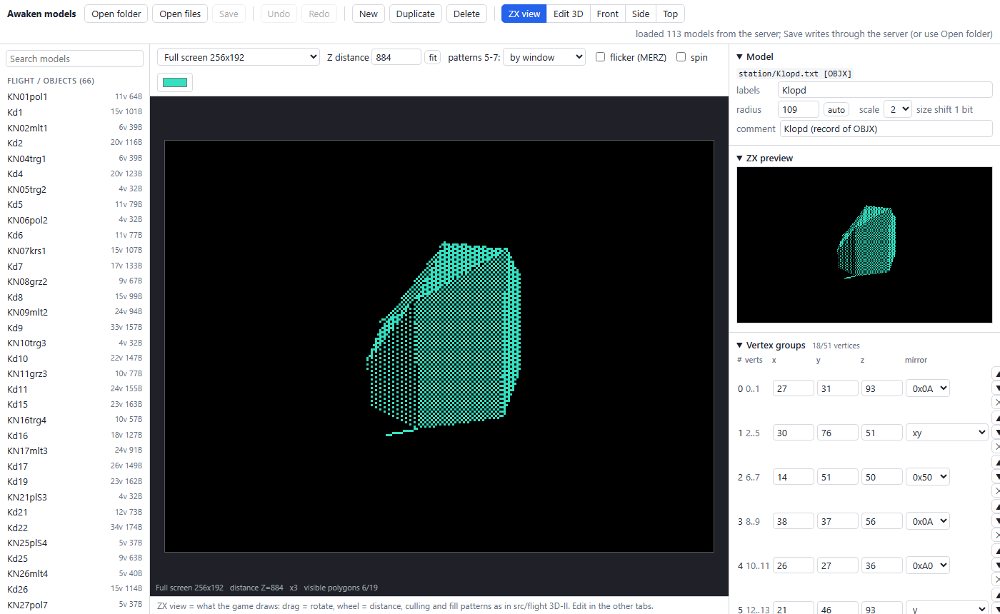

## Сборка

Нужны Python 3 (с Pillow) и sjasmplus 1.23 (в PATH или `C:\sjasmplus`).

    python build.py                  # build/awaken.trd (+ awaken_nointro.trd, символы build/*.sym/.lst)
    python build.py --test-return    # тест: полёт сразу возвращается на станцию
    python build.py --test-ending    # тест: «Вылет» запускает концовку
    python build.py --storm          # собрать блок STORM (src/storm, в игру не входит)

`build/awaken.trd` запускается в эмуляторе Pentagon/128K с TR-DOS (`RUN`): заставка (пробел
пропускает) → станция → «Вылет» → полёт → стыковка → станция. Хватает 128 КБ.

Проверка, что исходники собираются в те же байты, что бинарники 1999 года на дисках разработчика:

    python tools/rebuild_all.py      # распаковка archive/*.trd, декодирование ZASM/STORM, конвертация, сверка
    python tools/verify_original.py all

## Управление

* Станция: `Q` вверх, `A` вниз, `O` влево, `P` вправо (или Kempston), `Пробел` — нажать, `M` — отмена /
  системное меню на пустом фоне (сохранение «Сохраниться», загрузка «Восстановиться», настройки).
* Полёт: `A` лазер, `S` / `X` тангаж, `N` / `M` крен, `Пробел` — тяга. Стыковка — влететь в станцию
  (стыковочного компьютера нет).

## Что где лежит

* `src/station`, `src/flight` — игра (станция и полёт); `src/boot` — загрузчик и заставка;
  `src/common` — диск, переход станция ↔ полёт, запись состояния.
* `src/storm` — прототипы 1997–98 года на STORM (посадка на планету LAND, воксели, 3D), отдельный блок.
* `src/legacy`, `original_src` — старые и исходные версии модулей, как на дисках.
* `assets/` — тексты (`text/`), таблицы (`data/`), графика (`gfx/`), модели (`models/`), звук и музыка;
  описание форматов и локализации — `assets/README.md`.
* `tools/assets` — конвертеры ассетов; `tools/model_editor` — редактор моделей
  (`python tools/model_editor/serve.py --open`); `tools/xp` — прогон сценариев в эмуляторе Xpeccy+.
* `archive/` — диски разработчика (`awk1..6.trd`), источник всех исходников.
* `docs/` — `GAME_DESIGN.md` (устройство игры: тексты, корабли, экономика, карта, ИИ, сюжет,
  неиспользованное, что не доделано), `ANALYSIS.md` (восстановление, карта памяти),
  `TESTING.md`, `STORM.md`, `ZASM_FORMAT.md`, таблицы меток.

## Состояние

Игра собирается и работает: заставка, станция (торговля, оснащение, карта, корабли, сохранения),
полёт, стыковка и возврат. Проверено в Xpeccy+ (Pentagon 512 и 128).
Чего нет, потому что не было и у авторов: контрактов и миссий (только заготовки интерфейса),
сюжета, условия победы и гибели игрока; концовка есть, но ничем не вызывается.
Подробно — `docs/GAME_DESIGN.md`, раздел 9.

## Права

*Awaken* — © Mythos, 1999 (Сергей Апетёнок и команда). Исходники опубликованы проектом
Open Source ZX (opensourcezx.untergrund.net). Музыка станции — Mast/FtL. Исходные тексты,
графика, тексты и данные игры выложены для сохранения, изучения и некоммерческих модификаций;
права на них принадлежат авторам. Демо-версии игры есть на [zxart.ee](https://zxart.ee).

Инструменты проекта (`build.py`, `tools/`, документация) — под лицензией MIT, см. `LICENSE`.
